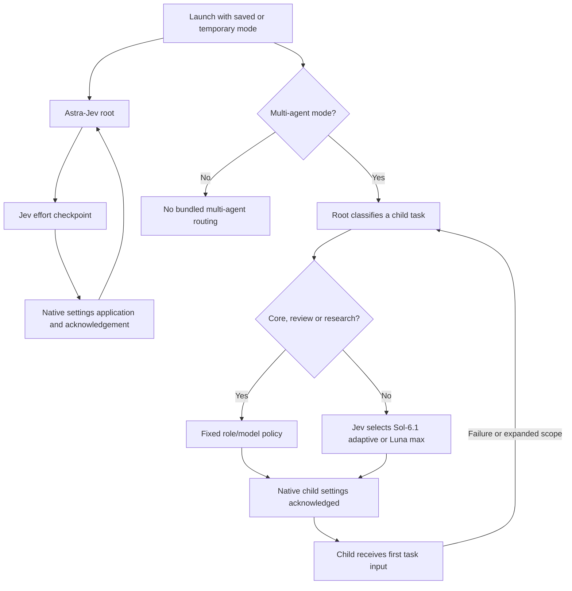

# Architecture

Astra-Ares Multi-Agent wraps a pinned native Codex 0.160.1 build. It uses local Unix sockets, not an HTTP proxy for your main model. Codex continues to own model authentication, model requests, tools, approvals, cancellation and conversation storage.

## Effort checkpoints

Stored selections `Astra-Jev`, `Sol-Jev`, `Sol-6.1-Jev` and `Luna-Jev` resolve to their corresponding native models. Before eligible generations, the native patch sends retained public context to the sidecar. Plain model selections bypass effort evaluation. The root defaults to Astra-Jev at medium, capped at high.

A lease counts model generations, not individual tools. Lease choices are bounded by config and never exceed five. New user input, model/effort changes and observed failures can end a lease. A local acknowledgement confirms settings on the captured step context before an applied record is emitted.

Where the model catalog advertises native reasoning-effort updates, the patch uses configuration updates while retaining the request baseline for prefix caching. This mechanism is tested at request boundaries; it does not prove a specific cache hit rate or cost reduction for a workload.

## Optional summary and failure isolation

The evaluator runs in an isolated worker. The parent watchdog is bounded at 32 seconds; a supported previous effort (or another supported fallback) receives a one-generation lease on a recoverable evaluator failure. A parent process that itself freezes cannot promise a real-time watchdog deadline.

Luna low can produce a semantic summary of the supplied context before Jev makes its decision. It cannot use execution tools. The native main history remains intact. Direct evaluation and failed-summary fallback still use explicit context budgets, so this is not unlimited context delivery. Private/encrypted reasoning is excluded from the public projection.

## Child task routing

Only multi-agent mode starts a task-router socket, injects bundled roles/policy, and enables orchestration by default. Native V1 exposes `multi_agent_v1.spawn_routed_agent`; V2 uses `routed_agents.spawn_routed_agent`. Independent namespaces avoid changing a gateway-reserved stock spawn schema. Without routing, stock native schemas remain unchanged.

Each route includes a task kind, short description, failure count, uncertainty, scope, known-effects flag and public/synthetic data class. Core implementation, review and research use fixed policies. Eligible local routine work uses a two-way Jev decision between Sol-6.1 adaptive and Luna max, with a dated price snapshot. Uncertain or unavailable routing has an explicit conservative fallback; it is logged as fallback rather than a successful Jev decision.

The selected role/model/effort is checked in native code. Initial child input is admitted only after the exact settings acknowledgement succeeds; failure or cancellation closes the pending child. Follow-ups continue the same task. Root reclassifies new work or expanded scope rather than changing a running child model in place.

## Boundaries

A route is not permission to execute, spend, publish or access data. Role instructions preserve workspace rules and task scope. Summary text and routing metadata are untrusted inputs, not policy overrides. Both modes share one history directory; switching launch policy does not migrate or erase conversations.

The native patch does not fix all upstream process-management issues. In particular, disconnect and managed-network rejection cleanup limitations were observed on the development host. See [validation](validation.md).
